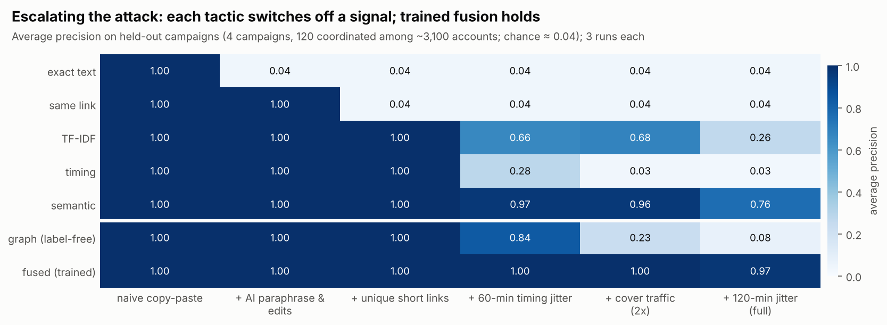
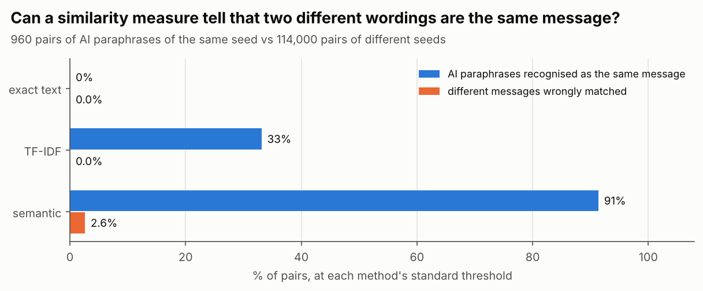
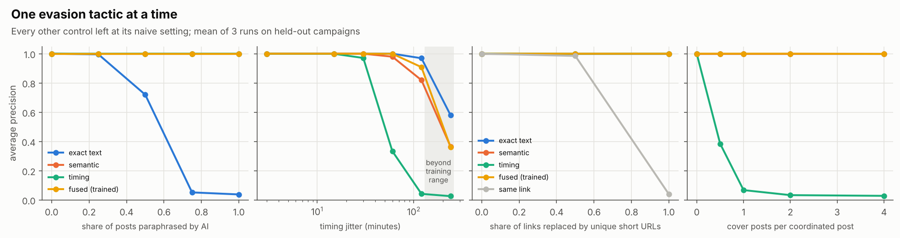
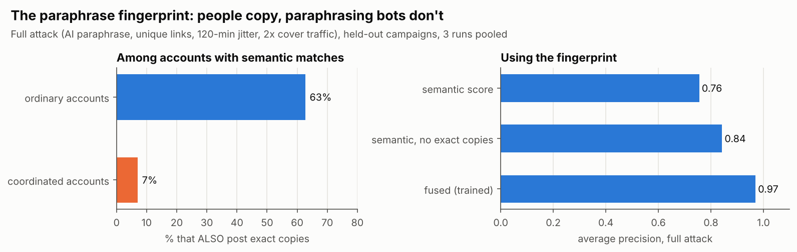
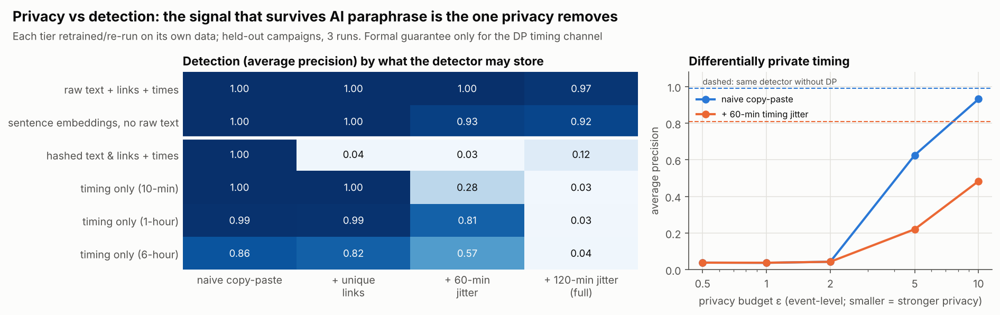

# Beyond Copy-Paste

**Detecting coordinated campaigns that paraphrase with AI, and how much user data that detection really needs.**

Most coordination-detection tools look for accounts that post the *same text* or the *same link*
at the *same time*. Generative AI breaks that assumption: a campaign can now give every account
its own wording, its own short link and its own posting time. This project asks two questions:

- **A. Detection.** Which coordination signals survive AI paraphrasing, link obfuscation, timing
  jitter and cover traffic, and does combining them help?
- **B. Privacy.** How much does detection depend on sensitive data (raw text, precise timestamps),
  and what does a formal privacy guarantee cost?



---

## Findings

### 1. AI paraphrase defeats copy-paste detection; semantic similarity recognises it

Pair-level test: 960 pairs of AI-written paraphrases of the same message vs 114,000 pairs of
different messages, each method at its standard threshold.

| Method | Paraphrases recognised as the same message | Different messages wrongly matched |
|---|---|---|
| Exact text (normalised) | 0% | 0% |
| Character TF-IDF (cosine ≥ 0.6) | 33% (AUC 0.999) | 0% |
| Semantic embeddings (calibrated threshold) | **91%** | 2.6% |

TF-IDF ranks paraphrases almost perfectly, but its usual threshold misses two thirds of them. The
semantic threshold (0.713) is set in advance at the 99.9th percentile of similarity between
unrelated posts, never on test data.



### 2. Each evasion tactic switches off one signal; a trained fusion holds

Average precision on held-out campaigns (chance ≈ 0.04) as tactics are switched on one after
another (figure above):

| Attack | Exact | Link | TF-IDF | Timing | Semantic | Graph (label-free) | **Fused (trained)** |
|---|---|---|---|---|---|---|---|
| Naive copy-paste | 1.00 | 1.00 | 1.00 | 1.00 | 1.00 | 1.00 | **1.00** |
| + AI paraphrase & edits | 0.04 | 1.00 | 1.00 | 1.00 | 1.00 | 1.00 | **1.00** |
| + unique short links | 0.04 | 0.04 | 1.00 | 1.00 | 1.00 | 1.00 | **1.00** |
| + 60-min timing jitter | 0.04 | 0.04 | 0.66 | 0.28 | 0.97 | 0.84 | **1.00** |
| + cover traffic (2×) | 0.04 | 0.04 | 0.68 | 0.03 | 0.96 | 0.23 | **1.00** |
| + 120-min jitter (full attack) | 0.04 | 0.04 | 0.26 | 0.03 | 0.76 | 0.08 | **0.97** |

- **Merging every signal without labels fails** (0.08). The noisy layers drown out the one that still works.
- **A fused detector trained on *different* campaigns holds at 0.97.** Removing semantic similarity
  drops it to 0.84, removing TF-IDF to 0.91; the other signals barely matter under this attack.
- **Volume is not the trick:** post count alone scores 0.10, and the fused model without volume or
  graph features still scores 0.96–0.97.



One tactic at a time: exact matching tolerates some rewording (0.72 when half the posts are
paraphrased) and then collapses (0.05 at 75%); timing similarity collapses with one cover post per
coordinated post (0.07). **The fused detector has limits:** at 240-minute jitter, beyond anything
it saw in training, it drops to 0.36, below plain exact matching (0.58).

### 3. The paraphrase fingerprint: people copy, paraphrasing bots don't

Why does fusion beat semantic similarity alone (0.97 vs 0.76)? Ordinary users who share the same
story post **identical** text, so they match both exactly and semantically. Paraphrasing accounts
match semantically but almost never exactly.

- Among accounts with semantic matches, **63% of ordinary accounts also post exact copies,
  against 7% of coordinated accounts.**
- A one-line rule, *semantic matches from accounts with no exact copies*, lifts semantic
  detection from 0.76 to 0.84. The trained model learns a richer version and reaches 0.97.

An adversary aware of this could mix verbatim copies back in. The fingerprint is a property of
today's paraphrasing campaigns, not a permanent defence.



### 4. Privacy vs detection: the signal that survives paraphrase is the one privacy removes

| What the detector may store | Naive | + unique links | + 60-min jitter | Full attack |
|---|---|---|---|---|
| Raw text + links + timestamps | 1.00 | 1.00 | 1.00 | 0.97 |
| Sentence embeddings, no raw text | 1.00 | 1.00 | 0.93 | 0.92 |
| Hashed text & links + timestamps | 1.00 | 0.04 | 0.03 | 0.12 |
| Timing only, 10-minute resolution | 1.00 | 1.00 | 0.28 | 0.03 |
| Timing only, 1-hour resolution | 0.99 | 0.99 | 0.81 | 0.03 |
| Timing only, 6-hour resolution | 0.86 | 0.82 | 0.57 | 0.04 |

- **Data minimisation works only against naive campaigns.** Hashed matching and timing-only
  detection are privacy-friendly but fail once content is paraphrased or cover traffic is added.
- **Dropping raw text costs little if embeddings are kept** (0.92 vs 0.97). Embeddings are not
  anonymous, though: text can be partly reconstructed from them.
- **Coarser timestamps can help against jitter** (1-hour bins: 0.81 vs 10-minute: 0.28), a rare
  case where less precise data is both more private and more robust.
- **Differential privacy on timing** (event-level Laplace mechanism, hourly counts): detection
  survives only at weak privacy budgets (naive campaigns: 0.93 at ε = 10, 0.63 at ε = 5; at
  ε ≤ 2 it falls to chance).



---

## Design

**Benchmark.** Real text, simulated behaviour, with every post in one schema
(`account, ts, text, url, campaign`) so a real dataset can be dropped in.

- **Ordinary accounts (3,000):** human-written Reddit comments (GoEmotions, 41,615 comments) and
  news shares from a pool of 12,000 headlines with heavy-tailed popularity. Popular stories are
  shared by many unrelated people within minutes, the classic false positive for copy-paste and
  link-based detectors. Human daily rhythm and session-clumped activity.
- **Campaigns (8 × 30 accounts):** each pushes 12 real seed messages (neutral news and
  hashtag-game posts from the IRA tweet archive) in coordinated waves. Campaigns 0–3 train the
  fused detector; **all results are on campaigns 4–7**, with different content and accounts.
- **AI paraphrases:** 384 rewrites (4 per seed) written by a large language model (Anthropic's
  Claude, October 2026) to keep each message's meaning while changing its wording. Median word
  overlap with the original is 35%, and 62% fall below the TF-IDF threshold.
- **Adversary controls:** share of posts paraphrased, light surface edits, timing jitter, links
  replaced by unique short URLs, and cover traffic.

**Detectors** (`src/detectors.py`). Account pairs posting the same thing within 15 minutes, with
at least 2 repetitions (one shared viral story is not coordination):
exact text (CooRTweet-style), same link (CooRnet-style), character TF-IDF, sentence embeddings
(coorsim-style, here SIF-weighted GloVe-Twitter), plus activity-timing similarity, label-free
Louvain communities on the union graph, and a gradient-boosting fusion.
[CooRTweet](https://github.com/nicolarighetti/CooRTweet) and [coorsim](https://github.com/thieled/coorsim)
are R packages; the baselines here reimplement their core matching logic in Python.

**Threat model for part B.** The asset is the data stored to run the detector. The adversary is
anyone who later obtains that store (a breach, an insider, a legal demand, or reuse for unrelated
profiling). The goal is to minimise what is learned about *ordinary* users while still detecting
coordinated ones. Only the timing channel gets a formal guarantee: each account's hourly activity
counts are released through the Laplace mechanism (one post changes one count by 1, so noise of
scale 1/ε gives ε-differential privacy per posting event), and everything afterwards is
post-processing. This protects *whether and when a single post happened*, not an account's overall
pattern. The content tiers are data minimisation, not formal privacy.

**Metrics.** Average precision over accounts (coordinated = positive) and recall at 1% false
positives (in `results/`); mean of 3 independent runs per setting.

## Run it

```bash
pip install -r requirements.txt
python src/run_all.py            # ~20 min on a 2-core laptop
```

**On real data** (e.g. Cresci-2017: genuine accounts plus a coordinated social-spambot group,
available on request from the MIB team; not redistributable):

```bash
python src/run_real.py data/your_data.csv --account user_id --ts created_at \
       --text text --url expanded_url --campaign campaign
```

## Limitations

- **Semi-synthetic.** The text is real but the behaviour is simulated, so the numbers describe
  this benchmark, not platform-scale accuracy. Validating on Cresci-2017 is the next step.
- **Limited paraphrase diversity.** With 4 rewrites per seed, several accounts share each rewrite,
  which flatters TF-IDF at the account level. The pair-level test (finding 1) removes this effect.
- **Weaker embeddings than the state of the art.** SIF-GloVe instead of transformer sentence
  embeddings; a stronger encoder would likely raise the semantic results further.
- **A parameterised adversary.** Real campaigns adapt to the detector. The fused model's drop at
  unseen jitter levels shows that a trained detector inherits the blind spots of its training data.

## Data and credits

Seed and headline text: IRA tweet archive (FiveThirtyEight / Linvill & Warren, Clemson).
Ordinary-user text: GoEmotions (Demszky et al., 2020). Word vectors: GloVe-Twitter
(Pennington et al., 2014). Paraphrases: generated for this project (`data/campaign_messages.json`).

*Author: Zubair, PhD student, University of Malakand.*
